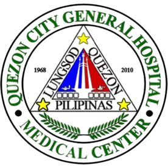

<div align="center">



# RADiTrack

**Radiology workload and turnaround-time monitoring for the QCGH Department of Radiology**

[**Open RADiTrack →**](https://raditrack.vercel.app)

</div>

---

## About

RADiTrack shows the Department of Radiology at Quezon City General Hospital how fast imaging reports are being read and signed. Each completed exam is tracked from the moment the scan finishes to the moment the radiologist signs the report. That time is the **Turnaround Time (TAT)**, and RADiTrack checks it against the department's **SLA targets** for each modality and patient category.

The department head sees backlog, SLA compliance and trends at a glance. Radiologists see what is waiting for them. Patients in the waiting area see the queue on a TV display.

RADiTrack stores **no patient names or identifying details**. Every exam is identified only by its accession number.

## Tech stack

<p align="center">
  
</p>

| Layer | Tools |
|---|---|
| App | Next.js 16 (App Router, server actions), React 19, TypeScript |
| Interface | Tailwind CSS 4, shadcn/ui, Lucide icons, Recharts 3 |
| Data | Prisma 7, PostgreSQL on Supabase |
| Sign-in | Encrypted session cookies (jose), bcrypt password hashing |
| Hosting | Vercel |

## Main users

| User | What they use RADiTrack for |
|---|---|
| **Department head and administrators** | Monitor TAT, SLA compliance and backlog; generate reports; manage SLA targets, modality rooms and staff accounts |
| **Radiologists and residents** | See the reading backlog for their assigned modalities and sign off reports |
| **Patients and families** | Watch the queue on the waiting-area TV display, which shows no personal details |

## Main features

- **Dashboard:** KPI cards for total scans, average and median TAT, SLA compliance and reading backlog, each compared with the previous period. Filter by time window, modality and patient category.
- **Charts:** TAT by modality against SLA targets, a 7-day breakdown, and a 12-month trend.
- **PDF reports:** choose the period, scope and sections, then save a printable summary.
- **Examinations:** backlog and finalized lists, accession search, sign-off, and Excel/CSV import and export.
- **Configurations:** SLA targets per modality and patient category, modality rooms and status, and staff accounts with assigned modalities.
- **Patient TV display:** a live, de-identified queue for the waiting area.
- **RIS Simulator:** log test scans and load a validation dataset for demonstrations (administrators only).
- **In-app guide:** explains every term, formula and time window used in the numbers.

## Quick start

You need [Node.js](https://nodejs.org) 20 or 22, Git, and the team's Supabase connection details.

1. **Clone the project and open the app folder:**
   ```bash
   git clone https://github.com/mgoblimar/RADiTrack.git
   cd RADiTrack/raditrack-dashboard
   ```
2. **Create your `.env` file** from the template:
   ```bash
   cp .env.example .env
   ```
   On Windows Command Prompt, use `copy .env.example .env`. Then fill in `DATABASE_URL` and `DIRECT_URL` (ask the team), and set `SESSION_SECRET` to a random string of at least 32 characters:
   ```bash
   node -e "console.log(require('crypto').randomBytes(48).toString('base64url'))"
   ```
3. **Install and prepare:**
   ```bash
   npm install
   npx prisma generate
   ```
4. **Start the app:**
   ```bash
   npm run dev
   ```
   Open http://localhost:3000 and sign in with the account your administrator gave you.

> The team database is shared with the live site. Don't run `prisma db push` or load test data without checking with the team first.

To ship changes, follow the branch and release steps in [docs/RELEASING.md](raditrack-dashboard/docs/RELEASING.md).

---

<div align="center">
<sub>CS 128.1 · University of the Philippines Manila · Group O(n) point</sub>
</div>
